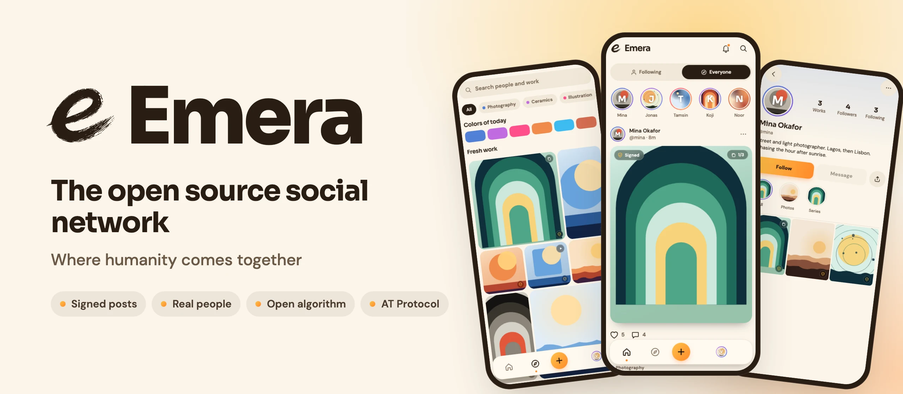
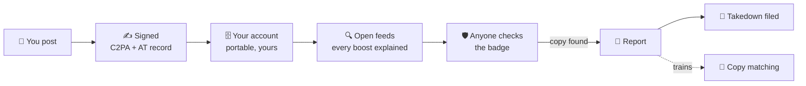

<div align="center">

<a href="https://emera.social">
  <picture>
    <source media="(prefers-color-scheme: dark)" srcset="brand/readme/banner-dark.webp">
    
  </picture>
</a>

<br>

[](https://github.com/royherma/emera/actions/workflows/ci.yml) [](#license) [](https://atproto.com) [](docs/mission/mission.md) [](CONTRIBUTING.md)

**[✨ Join Emera](https://app.emera.social)** &nbsp;·&nbsp; **[🌐 Website](https://emera.social)** &nbsp;·&nbsp; **[🧭 Mission](docs/mission/mission.md)** &nbsp;·&nbsp; **[🗺️ Roadmap](#roadmap)** &nbsp;·&nbsp; **[💡 Suggest a feature](https://github.com/royherma/emera/issues/new?template=feature.yml)** &nbsp;·&nbsp; **[🙌 Contribute](#contribute)**

</div>

---

## ✨ Why Emera

Manipulation, bots and fakes reach more people than ever, and the feeds reward them. Making things and finding real ones has turned slow and wasteful: you scroll past noise, you can't tell what is real, and when your work gets copied no one helps. The platforms we have are not fixing it.

So we are fixing it together, in the open. Emera is a place to share what you create and what helps each other, where **anyone can check** who made a post, why the feed shows it, and what the rules are. Every line of code is public, it runs as a nonprofit, and it sits on the [AT Protocol](https://atproto.com), so no one can quietly change the rules on you.

<table>
  <tr>
    <td width="50%" valign="top">
      <h3>🛡️ Proof of who made it</h3>
      Every post carries a signed record of its maker. The badge says exactly what was checked, nothing more.
    </td>
    <td width="50%" valign="top">
      <h3>🧑‍🤝‍🧑 Real people</h3>
      People are marked as people. Automated accounts say so, out loud.
    </td>
  </tr>
  <tr>
    <td width="50%" valign="top">
      <h3>🔍 An open algorithm</h3>
      The ranking code is public, and every boost has a reason you can read.
    </td>
    <td width="50%" valign="top">
      <h3>🔑 You own your account</h3>
      Your posts and followers go with you, any time, to any AT Protocol app.
    </td>
  </tr>
</table>

> [!TIP]
> **Someone copied your work?** Report it from any post. We help file the takedown, and every report trains the copy matching that comes next.

## 🚀 Join in four steps

<table>
  <tr>
    <td align="center" width="25%"><h3>1️⃣</h3><b>Open the app</b><br><sub><a href="https://app.emera.social">app.emera.social</a>, no invite needed</sub></td>
    <td align="center" width="25%"><h3>2️⃣</h3><b>Type your email</b><br><sub>We send a code, no password</sub></td>
    <td align="center" width="25%"><h3>3️⃣</h3><b>Say your name</b><br><sub>Your handle fills itself in</sub></td>
    <td align="center" width="25%"><h3>4️⃣</h3><b>Post</b><br><sub>Signed with your name from the first upload</sub></td>
  </tr>
</table>

<p align="center"><a href="https://app.emera.social"></a></p>

## 📸 What you can post

| | Format | What works today |
| :-: | --- | --- |
| 🖼️ | **Photos** | JPEG, PNG, WebP, HEIC up to 20 MB. Stored sharp at up to 2048 px |
| 🎬 | **Video** | MP4 and MOV up to 200 MB, portrait or landscape. 4K clips up to 60 s are turned into 1080p for smooth playback |
| 🎠 | **Carousels** | Up to 10 photos and videos in one post, swipe through |
| ✍️ | **Caption** | Up to 2,200 characters, one per post |
| 💬 | **Comments** | Up to 500 characters each |
| 🛡️ | **Proof** | Every file is fingerprinted and signed with its maker's name on upload |

<sub>Need another format? [Suggest it](https://github.com/royherma/emera/issues/new?template=feature.yml), the most asked for goes first.</sub>

## ⚙️ How it works



<a id="roadmap"></a>

## 🗺️ Roadmap

| | Milestone | Target | Progress | Exit test |
| :-: | --- | --- | --- | --- |
| 🌅 | **M0** Live on emera.social | Nov 16, 2026 |  | emera.social, app and API live |
| 🌱 | **M1** First 100 creators | Dec 31, 2026 |  | 100 creators, 40 reports, half of notices end in removal in 14 days |
| 🌍 | **M2** 1,000 creators | Mid-Feb 2027 |  | 35% still posting after 30 days, 5 outside contributors merged |
| ☀️ | **M3 + M4** 10K, then 100K creators | 2027 |  | Creators paid, copy matching for everyone |

Dates are targets, not limits: the sooner one lands, the sooner the next one starts.

<sub>Open a milestone for its items: ✅ done · 🟡 in progress · ⬜ next. Full plan with costs and risks in [docs/master-plan.md](docs/master-plan.md).</sub>

<details>
<summary><b>🌅 M0 · Live on emera.social</b></summary>

- ✅ [emera.social](https://emera.social), [app.emera.social](https://app.emera.social) and [api.emera.social](https://api.emera.social/health) live
- ✅ Sign up with an email code, invite links
- ✅ Post, follow, like, comment, search, notifications
- ✅ Report a copy of your work, from any post
- 🟡 Sign-in email lands in the inbox, not spam, 3 of 3 tries
- ⬜ @emerasocial on TikTok, YouTube, Instagram and Bluesky
- ⬜ DMCA agent registered
- ⬜ Founder profile with the first 10 posts

</details>

<details>
<summary><b>🌱 M1 · First 100 creators</b></summary>

- ✅ Public repo, CONTRIBUTING, code of conduct, security policy
- ✅ Error alerts and visitor numbers
- ✅ Bring your old posts over (`tools/import`)
- ⬜ Takedown notice builder: the creator confirms, we send it
- ⬜ Ops page to file and track every report
- ⬜ Abuse and CSAM basics

</details>

<details>
<summary><b>🌍 M2 · 1,000 creators</b></summary>

- ⬜ Own PDS and portable accounts
- ⬜ Passkeys
- ⬜ Creator dashboard: your reports, outcomes, receipts
- ⬜ Open feeds with "why this post"
- ⬜ Public cost page and donations
- ⬜ Contributor program with bounties

</details>

<details>
<summary><b>☀️ M3 + M4 · 10,000 then 100,000 creators</b></summary>

- ⬜ Automatic copy matching, trained on the reports creators send
- ⬜ Tips and Premium, money paid to creators
- ⬜ Video on our own streaming
- ⬜ Scanning for everyone, platform integrations, board elections

</details>

## 📱 Platforms

Emera goes on every screen creators and their audiences use. Tech path, effort and owners per platform: [docs/platforms.md](docs/platforms.md) · data in [data/platforms.json](data/platforms.json).

| | Group | Platforms | Status |
| :-: | --- | --- | --- |
| 🌐 | **Web** | Desktop and mobile web, PWA | ✅ Web live · PWA planned |
| 📱 | **Phones** | iOS, Android | 🟡 In code (Expo) |
| 📲 | **Tablets** | iPad, Android tablets | 🟡 In code, layout planned |
| 📺 | **TVs** | Apple TV, Android TV, Google TV, Fire TV, Roku, Tizen, webOS | ⬜ One `react-native-tvos` build covers three |
| 💻 | **Desktop** | macOS, Windows, Linux | ⬜ PWA first |
| 🔗 | **Reach** | Share cards, oEmbed, RSS, email digests, Bluesky feeds, browser extension | ⬜ Planned |
| ⌚ | **Other** | Watch, car, VR, assistants, smart displays | 💡 Ideas |

## 🚀 Run it locally

Node 22+ and npm. Each app has its own `package.json`.

| | App | Port | Start | Check |
| :-: | --- | :-: | --- | --- |
| ⚡ | **API** (Hono Worker, local D1 + R2) | 5036 | `npm --prefix apps/api run dev` | `npm --prefix apps/api test` |
| 📱 | **App** (Expo: iOS, Android, web) | 5037 | `npm --prefix apps/mobile run web` | `npm --prefix apps/mobile run check` |
| 🌐 | **Landing page** | 5038 | `npm --prefix apps/site run dev` | screenshots |
| ✍️ | **Provenance spike** | – | `npm --prefix spikes/provenance run demo` | prints `PASS` |

<details>
<summary><b>Full setup and every command</b></summary>

Install each app first:

```bash
npm --prefix apps/api install
npm --prefix apps/mobile install
npm --prefix apps/site install
```

**API.** Sign-in codes print in the wrangler log. In dev, invites are off.

```bash
npm --prefix apps/api run dev
npm --prefix apps/api test
npm --prefix apps/api run typecheck
npm --prefix apps/api run smoke
```

**App.** With no `EXPO_PUBLIC_API_URL` it runs on mock data. Point it at the API for the real thing:

```bash
npm --prefix apps/mobile run web
EXPO_PUBLIC_API_URL=http://localhost:5036 npm --prefix apps/mobile run web
npm --prefix apps/mobile run check
npm --prefix apps/mobile run ios
npm --prefix apps/mobile run android
```

**Landing page:**

```bash
npm --prefix apps/site run migrate:local
npm --prefix apps/site run dev
```

**Provenance spike** (signs an image, checks the signature, matches a copy):

```bash
npm --prefix spikes/provenance install
npm --prefix spikes/provenance run demo
npm --prefix spikes/provenance run lexicons
```

</details>

## 🧱 Repo layout

| | Path | What |
| :-: | --- | --- |
| ⚡ | [`apps/api`](apps/api) | Hono Worker: accounts, uploads, posts, public pages |
| 📱 | [`apps/mobile`](apps/mobile) | Expo app for iOS, Android and web |
| 🌐 | [`apps/site`](apps/site) | emera.social landing page and early list |
| 🔔 | [`apps/notify`](apps/notify) | Team alerts and the admin page |
| 🎨 | [`packages/brand`](packages/brand) | Name, tagline, colors and the AT Protocol namespace |
| 🧬 | [`lexicons`](lexicons) | AT Protocol record definitions, `social.emera.*` |
| ✍️ | [`spikes/provenance`](spikes/provenance) | C2PA signing and perceptual-hash matching |
| 📚 | [`docs`](docs) | Mission, master plan, architecture, API contract, platforms |
| 🗂️ | [`data`](data) | Machine-readable lists, such as platforms |

<a id="contribute"></a>

## 🙌 Build it with us

Emera gets better the way it was started: people bringing problems and solving them together. Three ways in:

| | Way in | Where |
| :-: | --- | --- |
| 💡 | **Suggest a feature** or a better way to do something | [Feature request](https://github.com/royherma/emera/issues/new?template=feature.yml) |
| 💬 | **Bring a problem** the community should solve, or ask anything | [Discussions](https://github.com/royherma/emera/discussions) |
| 🐞 | **Report a bug** | [Bug report](https://github.com/royherma/emera/issues/new?template=bug.yml) |

**Want to write code?** The core stays with the core team so it moves fast and stays safe. The projects around it are big, self-contained, and yours to own.

| 🔒 Core team builds | 🙌 You can own |
| --- | --- |
| Accounts, sign-in, invites | 🧩 **Browser extension:** report a copy of the page you are on |
| Posts, feeds, ranking | 🦋 **Bluesky:** feed generator for Emera creators, cross-posts |
| Proof of who made it (signing, badges) | 📺 **TV apps:** Android TV, Fire TV, Apple TV, Roku, Samsung, LG |
| Report a copy and takedowns | 🌐 **Translations:** Lingui setup and your language |
| Moderation and safety | ♿ **Accessibility:** screen reader pass, Reduce Motion, font scaling |
| Payments and payouts | 📲 **Tablet layout** for iPad and Android tablets |
| | 🐳 **Self-hosting:** Docker image for the API |
| | 🔗 **Embeds:** share cards, oEmbed, RSS feeds |

**Start in three steps:** read [CONTRIBUTING.md](CONTRIBUTING.md) → pick a project from the [help-wanted list](docs/help-wanted.json) → open an issue saying you are taking it, so two people never build the same thing.

<a id="license"></a>

## ⚖️ License

| Folder | License |
| --- | --- |
| `apps/api`, `apps/site` (servers) | **AGPL-3.0**, see [`apps/api/LICENSE`](apps/api/LICENSE) and [`apps/site/LICENSE`](apps/site/LICENSE) |
| Everything else: `apps/mobile`, `packages`, `lexicons`, `spikes`, `tools` | **MIT**, see [`LICENSE`](LICENSE) |

The Emera name, logo and brand artwork (`brand/`) are not covered by either license. Details in [CONTRIBUTING.md](CONTRIBUTING.md#licensing).

---

<div align="center">
  <a href="https://emera.social"></a>
  <br>
  <b>Emera</b> · Where humanity comes together
  <br>
  <sub>Built by Techguyver Labs for the Emera community · <a href="CODE_OF_CONDUCT.md">Code of conduct</a> · <a href="SECURITY.md">Security</a></sub>
</div>
