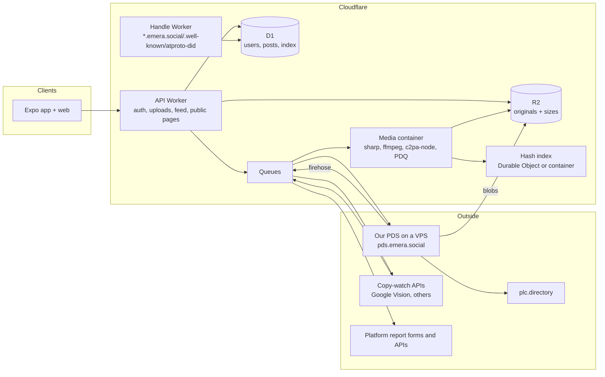
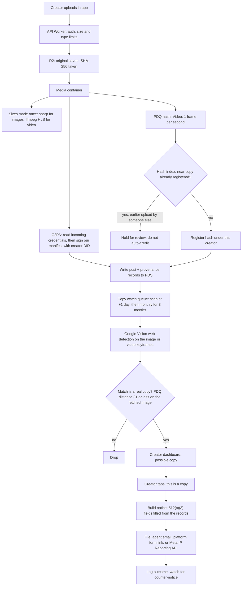

# Emera architecture

Written 2026-11-13. Name: Emera, domain emera.social, lexicon authority `social.emera`, handles like `roy.emera.social`. The folder is still `agora/`.

Every claim has a source link or is marked `[inferred]` (my reasoning, not read in a source). Numbers marked `[assumption]` are mine and are the first thing to replace with measured data.

## The short version

| Question | Answer |
| --- | --- |
| What runs where | v0 Worker + D1 + R2 stays the front door. One small Bluesky PDS on a VPS holds identities and records. A media container does image/video work. |
| Where the PDS runs | A small VPS (Hetzner-class), not Cloudflare Containers. Container disk is wiped on every restart. |
| When accounts become did:plc | At sign-up, from the first AT Protocol build on. Old v0 accounts are promoted by a queue job, one at a time. |
| When records go to the PDS | Identity first, records second (async outbox), PDS becomes the source of truth last. |
| Riskiest piece | Copy watch: it sees the open web, not the inside of Instagram, TikTok or YouTube, and its scan bill is 88% of infra cost. |
| Spike result | PDQ matches resize and recompress, tolerates about 1% crop, fails at 2% crop. C2PA signs, verifies, and detects tampering. See "Spike results". |
| Cost per creator per month | About 4 cents for hosting, 0.7 to 28 cents more for copy watch depending on how often we scan. |

Two things in `one-pager.md` do not hold up and are corrected here:

1. "Bluesky's open PDS on Cloudflare Containers" does not work as written. Container disk is ephemeral: "All disk is ephemeral by default", and a sleeping or restarted instance gets "a fresh disk from the container image" ([Cloudflare Containers architecture](https://developers.cloudflare.com/containers/platform-details/architecture/)). The PDS keeps accounts in SQLite files on disk ([bluesky-social/pds](https://github.com/bluesky-social/pds)). A restart would lose every account.
2. "Reverse-image search APIs" for off-network matches: Bing's search APIs were retired on 2025-08-11 ([Microsoft notice](https://learn.microsoft.com/en-us/lifecycle/announcements/bing-search-api-retirement)). I could not confirm whether Bing Visual Search was part of it. The usable options are in "Copy watch".

## 1. How v0 grows into AT Protocol

### What v0 is

The API agent is building a Cloudflare Worker with D1 (users, posts, invites) and R2 (media), per `api-contract.md`. Accounts are our own (email code now, passkeys next). A user has a handle, a display name and an id. No DID yet.

### The target



Plain reading: users talk only to our API. The API never lets the app talk to the PDS directly. The PDS is the record of truth for identity and posts; D1 is a fast copy built from it (our own small "AppView"). Because blobs are written to R2 by the PDS itself, there is one copy of each original.

### Where the PDS runs

| Option | Fits? | Why |
| --- | --- | --- |
| Reference PDS on Cloudflare Containers | No | Disk is wiped on restart, sleep and deploy. Persisting needs snapshots (Durable Object policy only) or an R2 FUSE mount, which Cloudflare warns is slower than SSD ([docs](https://developers.cloudflare.com/containers/platform-details/architecture/)). SQLite on a network mount is a corruption risk `[inferred]`. Smallest instance: 256 MiB RAM and 2 GB disk ([pricing](https://developers.cloudflare.com/containers/platform/pricing/)). |
| Fly.io machine + volume | Works | Volume $0.15/GB-month, 1 GB RAM machine roughly $6 to $7/month after the 2026 price change (third-party figures, check [fly.io/pricing](https://fly.io/pricing)). A volume lives on one host, so backups are on us. |
| Small VPS (Hetzner-class) | Chosen | The path Bluesky documents: Ubuntu 24.04, 1 GB RAM, 1 core, 20 GB SSD, public IPv4, ports 80 and 443 ([bluesky-social/pds](https://github.com/bluesky-social/pds)). Hetzner repriced on 2026-06-15 and I could not confirm current prices; budget $5 to $20/month per box ([Hetzner notice](https://docs.hetzner.com/general/infrastructure-and-availability/price-adjustment/)). |
| PDS written for Workers (Durable Object per account, R2 blobs) | Later | Exists: [Cirrus](https://github.com/ascorbic/cirrus) (single-user, "experimental beta software") and [pds.js](https://tangled.org/chadtmiller.com/pds.js). Neither is a drop-in for thousands of accounts. Revisit after launch: AT Protocol account migration is a standard flow, so we can move accounts later without asking users to do anything `[inferred]`. |

Decision: reference PDS (`@atproto/pds`, version 0.5.58 on npm today) in Docker on one VPS, blobs on R2.

- The PDS reads S3-style blob settings. I confirmed these variable names in the published package: `PDS_BLOBSTORE_S3_BUCKET`, `PDS_BLOBSTORE_S3_ENDPOINT`, `PDS_BLOBSTORE_S3_ACCESS_KEY_ID`, `PDS_BLOBSTORE_S3_SECRET_ACCESS_KEY`, `PDS_BLOBSTORE_S3_FORCE_PATH_STYLE`. R2 speaks S3, so originals live in R2 once `[inferred: not tested against R2]`.
- Also confirmed in the package: `PDS_SERVICE_HANDLE_DOMAINS` (we set `.emera.social`), `PDS_INVITE_REQUIRED` (defaults to true), `PDS_DID_PLC_URL`, `PDS_PLC_ROTATION_KEY_K` and `PDS_PLC_ROTATION_KEY_KMS_KEY_ID`.
- Backups: the whole `/pds` directory (accounts.sqlite, sequencer.sqlite, per-account stores) copied hourly to R2 `[inferred]`. Losing the PLC rotation key means we cannot fix users' identities; store it offline plus in a second place.
- Sharding: one account lives on one PDS. If one box saturates, add `pds2.emera.social`. Handles and DIDs do not change.
- Scale is unmeasured. The README sizes the 1 GB box for "1-20" users ([bluesky-social/pds](https://github.com/bluesky-social/pds)). It says nothing about thousands. A load test with 10,000 synthetic accounts is the first build task (see "Build order").

### Accounts: from v0 user to did:plc

A did:plc is made when a PDS creates an account: the PDS generates the keys and submits the first operation to plc.directory, signed with the PDS rotation key. The PDS can be replaced later through the standard migration flow, where the old PDS signs the identity update after an emailed token ([account migration guide](https://atproto.com/guides/account-migration)).

New sign-ups (from the AT Protocol build on):

1. User verifies email (our 6-digit code or passkey, as in v0) and picks `roy`.
2. API calls `com.atproto.server.createAccount` on our PDS with the email, handle `roy.emera.social`, a random 32-byte password, and an invite code the API minted with the admin password.
3. PDS returns the DID and tokens. API stores `did`, the password (encrypted with a Workers secret) and the refresh token on the user row.
4. API writes the profile records (see section "Records").

Existing v0 users: a queue job `promote(userId)`, idempotent, run in batches.

1. Skip if `did` is set. Otherwise do steps 2 to 4 above with the stored email and handle.
2. Backfill posts from D1 oldest first, in batches. The blob comes from R2, the record gets a TID record key built from the original `createdAt`, so a re-run overwrites instead of duplicating.
3. Mark `promoted_at`. Failures retry with backoff; a failed account stays fully working on v0.

Handles on our domain. Point `*.emera.social` at a small Worker that answers `https://roy.emera.social/.well-known/atproto-did` with the DID from D1, and send everything else to the profile page. The PDS itself lives at `pds.emera.social`, not the wildcard. This keeps handle resolution alive when the PDS is down. `[inferred: the PDS should skip external handle checks for domains listed in PDS_SERVICE_HANDLE_DOMAINS; the PDS README requires a wildcard DNS record pointing at the PDS for sign-ups, so confirm this Worker variant in the PDS bring-up task.]`

Leaving. Our login is ours, so the PDS password is random and the user never sees it. "Export and leave" = user triggers the PDS password reset to their email, sets their own password, and can then use any migration tool. For adversarial cases, offer to add a user-held rotation key to their did:plc during promotion so they do not need us. The page says the old PDS may help with PLC recovery only during a fixed 72-hour window ([migration guide](https://atproto.com/guides/account-migration)). A user-held rotation key avoids that dependence.

### When we write records to the PDS

| Stage | Source of truth | PDS writes |
| --- | --- | --- |
| A. Identity only | D1 | DID created at sign-up; profile records written. Posts stay in D1 only. |
| B. Shadow | D1 | Every post is also written to the PDS from an outbox table, async. Lag is watched. |
| C. Flip | PDS | API writes to the PDS first. A consumer reads our own PDS firehose (`com.atproto.sync.subscribeRepos`) into a Queue, which updates D1. |
| D. Open | PDS | PDS asks the public relay to crawl it, so other AT Protocol tools can read our records. Not before launch. |

Why this order: a DID is the one thing that cannot be redone, so it comes first. Records can be replayed from D1, so they can come later. Flip only when stage B lag has been under a minute for a week `[assumption]`.

## 2. Records (lexicons)

Drafts are in `lexicons/social/emera/`: `post`, `defs`, `actor/profile`, `provenance`. Validated with `@atproto/lexicon` 0.7.19 (`npm run lexicons` in `spikes/provenance`).

- `social.emera.post`: text, then `media` as a union of `#images` (1 to 10 images, each with alt text, aspect ratio and PDQ hash) or `#videoMedia` (one video, poster, duration). Optional license and a strong reference to its provenance record.
- `social.emera.actor.profile`: what you make, links, default license, and the `copyWatch` consent block (see section 4). Name, bio and avatar stay in `app.bsky.actor.profile` so other AT Protocol apps show something sensible `[inferred]`.
- `social.emera.provenance`: one per post. Per item: SHA-256 of the original bytes, PDQ hash (video: one hash per second), C2PA state, and where the file came from (captured, edited, ai-generated, unknown).

Renaming. The authority is the reversed domain, so it changes with the name. From `lexicons/`:

```
node rename-nsid.mjs social.emera org.newname
```

That moves the folders and rewrites every `id` and `ref`. Then update `nsidAuthority` in `packages/brand/brand.json`. Mismatch to fix: `brand.json` still says `org.techguyverlabs.agora`; I did not edit it (outside my folders). Rename before the first real record is written: after that, old records keep the old NSID forever.

What the validator does not check: blob `accept` and `maxSize` are not enforced by `@atproto/lexicon` (a record with a GIF in an image slot passed in my test, so I removed that case). The API must enforce file types and sizes itself.

## 3. Upload to proof to fingerprint to copy watch



What matters about this path:

- Signing and PDQ run in a container, not a Worker. `@contentauth/c2pa-node` is a native addon (the package ships `dist/index.node`, a Mach-O binary on my machine; Linux x86_64 and arm64 builds are listed in its [README](https://github.com/contentauth/c2pa-js/tree/main/packages/c2pa-node)). `sharp` is native too. A browser/WASM sibling, `@contentauth/c2pa-web` 0.17.0, has a `Builder`, but I did not test it inside a Workers isolate.
- Signing certificate. The spike uses a self-made test chain, which verifies as "Valid" and, once our test root is added as a trust anchor, "Trusted". For other apps (Adobe's verifier etc.) to show it as trusted, the certificate must trace back to the C2PA trust list. The route is: pass the C2PA conformance program, get a Conformance Letter, then buy a claim-signing certificate from an approved CA ([C2PA conformance](https://opensource.contentauthenticity.org/docs/conformance/), [SSL.com walkthrough](https://www.ssl.com/article/how-to-submit-to-the-c2pa-conformance-program/); the fee is set by each CA and I did not find a number). Lead time unknown. Start the application in week 1.
- One platform signing key signs on behalf of every creator, with the creator's DID inside the manifest (the spike's `author` field). A certificate per creator is not practical `[inferred]`.
- Almost every platform re-encodes uploads, which destroys the C2PA manifest (the spike shows this: after resize and recompress, `Reader` finds no manifest). C2PA proves "we saw these bytes first". PDQ is what finds copies.
- Hash index size: 32 bytes per hash. 1M hashes scanned in 15 ms in Node on this Mac (random data exits early, so a real worst case is slower) `[measured, spike benchmark]`. At 10,000 creators and about 120 images each, that is 1.2M hashes, 38 MB: one Durable Object. At 100,000 creators it is 12M hashes, 384 MB: one container with the index in memory, or shards.

## 4. Copy watch, off-network

### Honest scope

What we can promise at launch: "we search the public web for copies of your images and key video frames, and prepare the takedown notice for you." What we cannot promise yet: watching inside Instagram, TikTok or YouTube feeds, or finding AI re-creations. Reasons:

- Google Vision Web Detection returns "Web references": `fullMatchingImages`, `partialMatchingImages`, `pagesWithMatchingImages`, default 10 results, no completeness guarantee ([docs](https://docs.cloud.google.com/vision/docs/detecting-web)). It is a public-web index. In-app feeds behind a login are mostly not in it `[inferred]`.
- Video copies need their own matcher; see the table.
- My test of a CLIP embedding (the "AI copy" candidate in `one-pager.md`) could not separate crops of one photo (cosine 0.82 to 0.96 for 5% to 30% crops) from a different shot of the same person (0.905). Run in the spike, deleted after. A copy-detection model (Meta's SSCD) or local-feature matching is the next thing to test `[inferred; not tested]`.

### Finding copies: what exists today

| Service | What it does | Cost | Fit |
| --- | --- | --- | --- |
| Google Cloud Vision, Web Detection | Reverse image search by API | First 1,000 units/month free, then $3.50 per 1,000 ([pricing](https://cloud.google.com/vision/pricing)) | Primary for images. Video only by sending frames. |
| TinEye API / MatchEngine | Reverse image search, crawls the web; MatchEngine indexes your own images | API bundles about $0.01 to $0.02 per search ([TinEye pricing](https://blog.tineye.com/new-image-search-pricing/)); MatchEngine $200/month for 1,000 searches, $500 for 30,000, $1,500 for 150,000 ([MatchEngine](https://help.tineye.com/article/211-matchengine-pricing)) | Backup source. 5x the per-search price of Vision. |
| SerpApi (Google Lens / reverse image endpoints) | Scrapes Google results | $25/month for 1,000 searches up to $275 for 30,000; sources disagree on middle tiers ([SerpApi](https://serpapi.com/)) | Fallback if Vision recall is poor. Terms-of-service risk `[inferred]`. |
| Bing Visual Search | Reverse image search | Retired with the Bing Search APIs on 2025-08-11 per Microsoft; Visual Search coverage unconfirmed ([notice](https://learn.microsoft.com/en-us/lifecycle/announcements/bing-search-api-retirement)) | Do not plan on it. |
| Pixsy | Monitors a creator's images; files cases; takes a share of money recovered | Free to submit cases; 50% of recovered fees for licensing resolution; subscription prices in sources conflict and their pricing page was a 404 in May 2026 ([Pixsy fees](https://support.pixsy.com/en/articles/83-what-is-the-resolution-fee-structure-in-pixsy-s-licensing-resolution-program)) | Partner or fallback for money recovery. I found no public API `[inferred]`. |
| Copytrack | Same idea as Pixsy | Pricing page returned 404; not verified | Treat as a Pixsy-style partner to approach, not an API to call. |
| YouTube Content ID | Automatic claims on re-uploads | Not open to individuals. Needs exclusive rights and a demonstrated need ([YouTube eligibility](https://support.google.com/youtube/answer/1311402)). | Out of reach for us directly. Only via a Content ID partner `[inferred]`. |
| Meta Rights Manager | Detects copies of videos on Facebook pages | Application required; API works on videos on pages only ([docs](https://developers.facebook.com/docs/graph-api/rights-manager-api)) | Not for creators' Instagram feeds. |
| Video matching | Frame hashes (our PDQ per second), or Meta's TMK+PDQF | Self-hosted, container CPU | Our own. Not tested yet. |

### Filing takedowns: what is possible

| Where | How to file | Can an agent file for the creator? | Automatable? |
| --- | --- | --- | --- |
| YouTube | Web form in YouTube Studio under Content detection; one request per allegation; legal name signature; direct links ([YouTube help](https://support.google.com/youtube/answer/2807622)) | Yes: "an authorized representative, such as an attorney, can submit on behalf of a copyright owner" | Not by API (none mentioned). The form needs the filer's signed-in session. Prefill and hand to the creator, or file as agent through a form-automation account `[inferred, check YouTube terms]`. |
| Instagram, Facebook | Copyright report form; or Meta IP Reporting API for "rights holders and their agents" ([Instagram form](https://help.instagram.com/contact/552695131608132/), [API announcement](https://developers.facebook.com/blog/post/2022/10/25/introducing-intellectual-property-reporting-api/)) | Yes, under penalty of perjury that you are authorized | The API needs a verified Business Account, a developer app and Meta's approval. Coverage of Instagram is not stated on the page; cost not stated. Apply early. |
| TikTok | Online copyright form; agents must attach a signed authorization letter or power of attorney ([Red Points guide, secondary](https://www.redpoints.com/blog/tiktok-dmca-takedown/)) | Yes, with the letter | Form only, as far as I found. |
| X | Copyright form. Could not fetch the page (403). | `[inferred: yes]` | `[inferred]` form only. |
| Websites and hosts | Email or form to the host's DMCA agent, listed in the public directory | Yes | Yes. Email is the easiest channel to automate, and covers the open-web matches Vision actually finds. |
| Google Search results | Google's legal removal form | `[inferred: yes]` | `[inferred]` form. |

### What is legally needed

- For Emera as a host: register a DMCA designated agent with the Copyright Office to keep safe harbor. The agent's details must be on our site and in the Office's directory ([17 U.S.C. 512(c)(2)](https://www.law.cornell.edu/uscode/text/17/512)). Fee $6 per designation, renewed every 3 years ([law firm summaries of the 2016 rule, check copyright.gov](https://www.gtlaw.com/ar/insights/2016/12/new-dmca-regulations-existing-new-designated-agents-must-register-online)).
- For each notice we file for a creator, 17 U.S.C. 512(c)(3)(A) requires six elements: a signature of a person authorized to act for the owner, the work identified, the infringing material identified, contact details, a good-faith statement, and a statement under penalty of perjury that the information is accurate and the signer is authorized ([statute](https://www.law.cornell.edu/uscode/text/17/512)).
- The creator's authorization must be explicit and recorded. That is the `copyWatch` block in `social.emera.actor.profile` (enabled, grantedAt, termsVersion, legalName). YouTube wants a full personal legal name, not a company name ([YouTube help](https://support.google.com/youtube/answer/2807622)).
- Liability: under 512(f), anyone who "knowingly and materially misrepresents" infringement is liable for damages and attorney fees ([statute](https://www.law.cornell.edu/uscode/text/17/512)). Fair use must be considered before sending (YouTube asks you to confirm it). Hence the design: the creator confirms each match, we never auto-file on a match alone. A lawyer reviews the terms and the notice template before launch. "Help them sue" is a referral, not our service.
- Registration is not required to send a DMCA notice, but is required before suing for US works `[inferred, confirm with counsel]`.

## 5. Costs per month

### Assumptions per creator per month `[assumption]`

| Item | Value |
| --- | --- |
| Posts | 12: 10 image posts, 2 video posts (30 s) |
| Stored media at steady state | 1.5 GB (originals + sizes + HLS), about 10 months of posting |
| API requests | 2,000 (the creator plus their audience), 7 ms CPU each = 14,000 ms |
| R2 Class A (writes) / Class B (reads past the CDN cache) | 100 / 3,000 |
| Queue operations | 200 |
| Copy-watch scans, full | Each image scanned 4 times (day 1, then monthly for 3 months) = 40; each video 5 keyframes x 4 = 40. Total 80 Vision units |
| Copy-watch scans, light | Scan once at upload: 20 units |
| Video encoding | 2 videos x $0.0036 (about 180 vCPU-seconds at $0.000020, `[inferred]` encode time) |
| Email | login codes, about $0 / $20 / $200 `[inferred]` |

### Unit prices

- Workers: $5/month, 10M requests then $0.30 per million; 30M CPU ms then $0.02 per million ([Workers pricing](https://developers.cloudflare.com/workers/platform/pricing/)).
- R2: $0.015/GB-month; $4.50 per million writes; $0.36 per million reads; 10 GB, 1M writes and 10M reads free; free egress ([R2 pricing](https://developers.cloudflare.com/r2/pricing/)).
- D1: 25B reads and 50M writes included, 5 GB included ([D1 pricing](https://developers.cloudflare.com/d1/platform/pricing/)). Our use is far below that, so $0.
- Queues: 1M operations included, then $0.40 per million ([Queues pricing](https://developers.cloudflare.com/queues/platform/pricing/)).
- Containers: $0.000020 per vCPU-second ([pricing](https://developers.cloudflare.com/containers/platform/pricing/)).
- Vectorize: not used in v1 (CLIP failed my test). If added: about $100/month at 100,000 creators per the page's formula, (queried + stored vectors) x dimensions x $0.01 per million ([pricing](https://developers.cloudflare.com/vectorize/platform/pricing/)).
- PDS box: $6 (1k), $24 (10k, one 4 GB box), $144 (100k, 3 boxes at $48) `[assumption: box counts unmeasured]`. Hash index host: $0 until 100k, $30 after.
- Vision: $3.50 per 1,000 units after 1,000 free.

### The math

Workers = 5 + (requests - 10M) x 0.30/M + (CPU ms - 30M) x 0.02/M.

| Line | 1,000 creators | 10,000 | 100,000 |
| --- | --- | --- | --- |
| Workers | 5 (2M requests, inside free allowance) | 5 + (20M-10M) x 0.30 + (140M-30M) x 0.02 = 10 | 5 + 190 x 0.30 + 1,370 x 0.02 = 89 |
| R2 storage | (1,500 - 10 GB) x 0.015 = 22 | (15,000 - 10) x 0.015 = 225 | (150,000 - 10) x 0.015 = 2,250 |
| R2 operations | 0 (inside free tier) | (1M - 1M) x 4.5 + (30M - 10M) x 0.36/M = 7 | 9 x 4.5 + 290 x 0.36 = 145 |
| Queues | 0 | 1 | 19 x 0.4 = 8 |
| PDS + hash index | 6 | 24 | 144 + 30 = 174 |
| Video encode | 2,000 x 0.0036 = 7 | 72 | 720 |
| Email `[inferred]` | 0 | 20 | 200 |
| **Hosting total** | **40** | **359** | **3,586** |
| Hosting per creator | 4.0 cents | 3.6 cents | 3.6 cents |
| Copy watch, light (20 units) | (20,000 - 1,000) x 3.5/1k = 67 | 697 | 6,997 |
| Copy watch, full (80 units) | (80,000 - 1,000) x 3.5/1k = 277 | 2,797 | 27,997 |
| **Total with light scans** | **107** | **1,056** | **10,583** |
| **Total with full scans** | **317** | **3,156** | **31,583** |
| Total per creator, full | 31.7 cents | 31.6 cents | 31.6 cents |

All amounts in US dollars per month. Hosting total sums the rows above it (rounded); for example at 10,000: 10 + 225 + 7 + 1 + 24 + 72 + 20 = 359.

Reading it:

- BOTTLENECK: the Vision scan bill, 88% of full-cadence cost (27,997 of 31,583 at 100k). Storage is next at 2,250.
- A creator on the one-pager's $4/month Premium covers full scans (28 cents) 14 times over. The free tier can afford one scan per image (7 cents). That is the pricing logic: free = scan once, Premium = rescans plus the notice builder.
- People are not in the table. The one-pager's $6,000/month per head and a ratio of 1 per 20,000 creators for copyright disputes `[assumption]` gives 0 / 0.5 / 5 people = $0 / $3,000 / $30,000. At 100k creators, people cost as much as every server combined. Lawyer retainer: unpriced, ask counsel.
- Free credits and grants (Cloudflare for Startups) are not netted out.

## 6. Build order

Risk first: the things that can kill the plan go before the things that are merely work.

1. Done in this folder: provenance spike (PDQ + C2PA) and lexicon drafts.
2. Week 1, in parallel with v0 shipping:
   - Start the C2PA conformance application for a real signing certificate (lead time unknown).
   - Start the Meta IP Reporting API application (needs a verified Business Account).
   - Register the DMCA agent ($6).
   - Book counsel for the copy-watch terms and notice template.
3. Weeks 1 to 2: PDS bring-up on one VPS, blobs on R2, handle Worker on `*.emera.social`. Load test with 10,000 synthetic accounts and a firehose consumer. Exit: p95 createAccount and createRecord times written down, box count for 100k known.
4. Weeks 2 to 3: media container with sizes, C2PA signing and PDQ; hash index; "held for review" instead of auto-credit on a near match (guards against someone uploading another creator's work first).
5. Weeks 3 to 4: stage A (DIDs at sign-up) and the `promote` job for v0 users; stage B (shadow writes with an outbox).
6. Weeks 4 to 6: copy watch v1: Vision scans (light, then full), 10 test creators, hand-check every match. Exit: measured share of reported matches that are real copies, and how many Instagram or TikTok copies we found at all. If the open-web yield is low, the "watch other platforms" headline gets rewritten before launch, not after.
7. Weeks 6 to 8: creator dashboard, notice builder, email-agent filing, platform form prefill; Meta API if approved.
8. Weeks 8 to 10: stage C (PDS becomes source of truth, firehose into D1), user-held rotation key and "Export and leave".
9. After launch: video frame matching, a crop-robust second matcher (SSCD or local features), stage D (open crawl), Workers-native PDS evaluation, passkeys.

## 7. Top 5 risks

| # | Risk | Evidence | What we do |
| --- | --- | --- | --- |
| 1 | The headline promise outruns what we can see. Reverse search covers the public web; in-app feeds, video and AI re-creations are mostly invisible, and scans are 88% of cost | Vision returns "Web references" only; CLIP test failed to separate crops from other shots; Content ID closed to individuals | Promise "the open web" at launch. Measure yield on real creators in weeks 4 to 6. Scan cadence tied to paid tier. |
| 2 | A wrong or unauthorized takedown. Perjury statement and 512(f) damages attach to the sender; fair use must be considered | 512(c)(3)(A) and 512(f) text; YouTube asks about exceptions | Creator confirms each match; recorded authorization; lawyer-reviewed template; never auto-file on a match alone. |
| 3 | Registry poisoning. First uploader wins, so a thief who uploads first gets "Original by @x" and files notices against the real owner | Design consequence of "the original always wins" in `one-pager.md` `[inferred]` | Near match to an earlier hash is held for review, not auto-credited. C2PA from a camera or an earlier public date beats ours. Counter-notice path from day one. |
| 4 | PDS scale and key custody. Documented size is 1 to 20 users per 1 GB box; the rotation key and `/pds` backups are the whole identity layer | README sizing; PDS stores accounts in SQLite on disk; identities depend on the rotation key | Load test before any promotion job. Offline rotation key copy. Hourly backups to R2 with a restore drill. User-held rotation key option. |
| 5 | Fingerprints are weaker than the pitch. PDQ lost at 2% crop and on a mirror flip; C2PA is stripped by re-encoding; a trusted C2PA certificate needs a conformance letter | Spike output below; [C2PA conformance](https://opensource.contentauthenticity.org/docs/conformance/) | Say "resize, recompress and light edits". Add flipped-hash lookup and a second matcher. Start the certificate application now. |

## 8. Spike results

`spikes/provenance` (Node 22, `sharp` 0.35.5, `pdq-wasm` 0.3.9, `@contentauth/c2pa-node` 0.11.0, `@atproto/lexicon` 0.7.19). `npm run demo` output from this machine:

```
PDQ perceptual hash (256 bits, Hamming distance, match if <= 31)
  original hash 74a0cd00159c23a6ec77ecdd1117d237cc44998db6d8e76dbed609bf030ac555  quality 100
  resize 50%                 distance   4  MATCH
  resize 25%                 distance   8  MATCH
  crop 1% off each edge      distance  22  MATCH
  crop 2% off each edge      distance  44  no match  (known PDQ limit: needs a second layer)
  crop 5% off each edge      distance  92  no match  (known PDQ limit: needs a second layer)
  crop 10% off each edge     distance 114  no match  (known PDQ limit: needs a second layer)
  recompress q30             distance   8  MATCH
  resize 50% + crop + q40    distance 112  no match  (known PDQ limit: needs a second layer)
  mirror flip                distance 120  no match  (known PDQ limit: needs a second layer)
  different image            distance 120  no match

C2PA manifest (c2pa-node, test certificate, ES256)
  signed: 81011 bytes -> 135813 bytes
  verify untouched          state Valid, failures 0, creator did:plc:examplecreator123, signer Agora Spike
  verify with our root CA   state Trusted
  verify 1 byte flipped     state Invalid, failures assertion.dataHash.mismatch
  verify after resize+recompress   no manifest: Cannot read properties of null (reading 'getActive')
  ...but PDQ still links it to the original: distance 4

PASS
```

What it shows:

- PDQ survives resize and recompression with room to spare (4 to 8 against a threshold of 31; unrelated images land near 120, which is what random 256-bit hashes should give).
- PDQ is not crop-tolerant. A real photo (a 720x790 still from `brand-photos`, checked in a one-off run) gave 22, 36, 48, 74 at 1%, 2%, 3%, 5% off each edge. The synthetic test image gave 22, 44, 66, 92. So about 1% is the edge of what it catches. Meta's own PDQ notes also say it does not guarantee rotation invariance ([ThreatExchange PDQ](https://github.com/facebook/ThreatExchange/tree/main/pdq)).
- What I tried to fix crops: register the original plus a grid of crop windows. With 101 hashes per image (3.2 KB, 2.1 s to build) random 65% to 100% crops matched 7 of 40; with 37 hashes, 1 of 40; false matches were 0 of 150. Not worth the storage. Dropped.
- C2PA: sign, verify as Valid, verify as Trusted when our test root is a trust anchor, and detect a one-byte change (`assertion.dataHash.mismatch`). A resized and recompressed copy loses the manifest entirely.
- Landmines found: `pdq-wasm`'s ES module entry throws "PDQ WASM module not available" in Node, so `src/pdq.js` loads its CommonJS entry; it is a one-maintainer package, last published 2025-11-08. The test certificate is a throwaway root plus a leaf (ES256, `emailProtection` extended key usage) made by `openssl` into the git-ignored `certs/` folder. I did not test whether a lone self-signed leaf would be accepted.
- The test images are synthetic (seeded shapes), so absolute distances will differ on real photos; the real-photo crop sweep above agrees on the limit.
