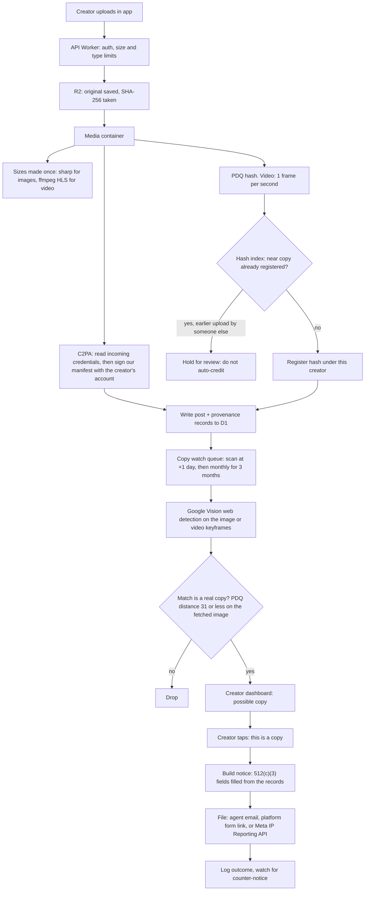

# Emera architecture

Written 2026-11-13. Name: Emera, domain emera.social, handles like `@roy`. The folder is still `agora/`.

Every claim has a source link or is marked `[inferred]` (my reasoning, not read in a source). Numbers marked `[assumption]` are mine and are the first thing to replace with measured data.

## The short version

| Question | Answer |
| --- | --- |
| What runs where | Worker + D1 + R2 is the whole front door and the source of truth for accounts and posts. A media container does image/video work. |
| Accounts | Our own accounts: email code now, passkeys next. No outside identity service. |
| Leaving | Export everything you made and your follower list, any time. |
| Riskiest piece | Copy watch: it sees the open web, not the inside of Instagram, TikTok or YouTube, and its scan bill is 88% of infra cost. |
| Spike result | PDQ matches resize and recompress, tolerates about 1% crop, fails at 2% crop. C2PA signs, verifies, and detects tampering. See "Spike results". |
| Cost per creator per month | About 3 cents for hosting, 0.7 to 28 cents more for copy watch depending on how often we scan. |

One thing in `one-pager.md` does not hold up and is corrected here:

1. "Reverse-image search APIs" for off-network matches: Bing's search APIs were retired on 2025-08-11 ([Microsoft notice](https://learn.microsoft.com/en-us/lifecycle/announcements/bing-search-api-retirement)). I could not confirm whether Bing Visual Search was part of it. The usable options are in "Copy watch".

## 1. Accounts and data

Emera is its own network (decided 2026-11-17: no AT Protocol; Bluesky is one import source like any other platform).

- Cloudflare Worker + D1 (users, posts, invites, follows) + R2 (media), per `api-contract.md`.
- Accounts are our own: email code now, passkeys next. A user has a handle, a display name and an id.
- D1 is the one source of truth. One database means one place to delete a person's data and one query to check a block.
- Leaving: export everything you made (original files plus captions and dates) and your follower list, any time.
- Importing: connectors read public posts from Bluesky, Mastodon, Pixelfed and feeds (`docs/connectors.md`). Read only.

## 2. Post and proof data

- A post: caption, `media` (1 to 10 images, each with a PDQ hash, or one video with poster and duration), optional license.
- A proof record per post. Per item: SHA-256 of the original bytes, PDQ hash (video: one hash per second), C2PA state, and where the file came from (captured, edited, ai-generated, unknown).
- Profile: what you make, links, default license, and the `copyWatch` consent block (see section 4).
- The API enforces file types and sizes.

## 3. Upload to proof to fingerprint to copy watch



What matters about this path:

- Signing and PDQ run in a container, not a Worker. `@contentauth/c2pa-node` is a native addon (the package ships `dist/index.node`, a Mach-O binary on my machine; Linux x86_64 and arm64 builds are listed in its [README](https://github.com/contentauth/c2pa-js/tree/main/packages/c2pa-node)). `sharp` is native too. A browser/WASM sibling, `@contentauth/c2pa-web` 0.17.0, has a `Builder`, but I did not test it inside a Workers isolate.
- Signing certificate. The spike uses a self-made test chain, which verifies as "Valid" and, once our test root is added as a trust anchor, "Trusted". For other apps (Adobe's verifier etc.) to show it as trusted, the certificate must trace back to the C2PA trust list. The route is: pass the C2PA conformance program, get a Conformance Letter, then buy a claim-signing certificate from an approved CA ([C2PA conformance](https://opensource.contentauthenticity.org/docs/conformance/), [SSL.com walkthrough](https://www.ssl.com/article/how-to-submit-to-the-c2pa-conformance-program/); the fee is set by each CA and I did not find a number). Lead time unknown. Start the application in week 1.
- One platform signing key signs on behalf of every creator, with the creator's account id inside the manifest (the spike's `author` field). A certificate per creator is not practical `[inferred]`.
- Almost every platform re-encodes uploads, which destroys the C2PA manifest (the spike shows this: after resize and recompress, `Reader` finds no manifest). C2PA proves "we saw these bytes first". PDQ is what finds copies.
- Hash index size: 32 bytes per hash. 1M hashes scanned in 15 ms in Node on this Mac (random data exits early, so a real worst case is slower) `[measured, spike benchmark]`. At 10,000 creators and about 120 images each, that is 1.2M hashes, 38 MB: one Durable Object. At 100,000 creators it is 12M hashes, 384 MB: one container with the index in memory, or shards.

## 4. Copy watch, off-network

### Honest scope

What we can promise at launch: "we search the public web for copies of your images and key video frames, and prepare the takedown notice for you." What we cannot promise yet: watching inside Instagram, TikTok or YouTube feeds, or finding AI re-creations. Reasons:

- Google Vision Web Detection returns "Web references": `fullMatchingImages`, `partialMatchingImages`, `pagesWithMatchingImages`, default 10 results, no completeness guarantee ([docs](https://docs.cloud.google.com/vision/docs/detecting-web)). It is a public-web index. In-app feeds behind a login are mostly not in it `[inferred]`.
- Video copies need their own matcher; see the table.
- My test of a CLIP embedding (the "AI copy" candidate in `one-pager.md`) could not separate crops of one photo (cosine 0.82 to 0.96 for 5% to 30% crops) from a different shot of the same person (0.905). Run in the spike, deleted after. A copy-detection model (Meta's SSCD) or local-feature matching is the next thing to test `[inferred; not tested]`.

### Finding copies: what exists today

| Service | What it does | Cost | Fit |
| --- | --- | --- | --- |
| Google Cloud Vision, Web Detection | Reverse image search by API | First 1,000 units/month free, then $3.50 per 1,000 ([pricing](https://cloud.google.com/vision/pricing)) | Primary for images. Video only by sending frames. |
| TinEye API / MatchEngine | Reverse image search, crawls the web; MatchEngine indexes your own images | API bundles about $0.01 to $0.02 per search ([TinEye pricing](https://blog.tineye.com/new-image-search-pricing/)); MatchEngine $200/month for 1,000 searches, $500 for 30,000, $1,500 for 150,000 ([MatchEngine](https://help.tineye.com/article/211-matchengine-pricing)) | Backup source. 5x the per-search price of Vision. |
| SerpApi (Google Lens / reverse image endpoints) | Scrapes Google results | $25/month for 1,000 searches up to $275 for 30,000; sources disagree on middle tiers ([SerpApi](https://serpapi.com/)) | Fallback if Vision recall is poor. Terms-of-service risk `[inferred]`. |
| Bing Visual Search | Reverse image search | Retired with the Bing Search APIs on 2025-08-11 per Microsoft; Visual Search coverage unconfirmed ([notice](https://learn.microsoft.com/en-us/lifecycle/announcements/bing-search-api-retirement)) | Do not plan on it. |
| Pixsy | Monitors a creator's images; files cases; takes a share of money recovered | Free to submit cases; 50% of recovered fees for licensing resolution; subscription prices in sources conflict and their pricing page was a 404 in May 2026 ([Pixsy fees](https://support.pixsy.com/en/articles/83-what-is-the-resolution-fee-structure-in-pixsy-s-licensing-resolution-program)) | Partner or fallback for money recovery. I found no public API `[inferred]`. |
| Copytrack | Same idea as Pixsy | Pricing page returned 404; not verified | Treat as a Pixsy-style partner to approach, not an API to call. |
| YouTube Content ID | Automatic claims on re-uploads | Not open to individuals. Needs exclusive rights and a demonstrated need ([YouTube eligibility](https://support.google.com/youtube/answer/1311402)). | Out of reach for us directly. Only via a Content ID partner `[inferred]`. |
| Meta Rights Manager | Detects copies of videos on Facebook pages | Application required; API works on videos on pages only ([docs](https://developers.facebook.com/docs/graph-api/rights-manager-api)) | Not for creators' Instagram feeds. |
| Video matching | Frame hashes (our PDQ per second), or Meta's TMK+PDQF | Self-hosted, container CPU | Our own. Not tested yet. |

### Filing takedowns: what is possible

| Where | How to file | Can an agent file for the creator? | Automatable? |
| --- | --- | --- | --- |
| YouTube | Web form in YouTube Studio under Content detection; one request per allegation; legal name signature; direct links ([YouTube help](https://support.google.com/youtube/answer/2807622)) | Yes: "an authorized representative, such as an attorney, can submit on behalf of a copyright owner" | Not by API (none mentioned). The form needs the filer's signed-in session. Prefill and hand to the creator, or file as agent through a form-automation account `[inferred, check YouTube terms]`. |
| Instagram, Facebook | Copyright report form; or Meta IP Reporting API for "rights holders and their agents" ([Instagram form](https://help.instagram.com/contact/552695131608132/), [API announcement](https://developers.facebook.com/blog/post/2022/10/25/introducing-intellectual-property-reporting-api/)) | Yes, under penalty of perjury that you are authorized | The API needs a verified Business Account, a developer app and Meta's approval. Coverage of Instagram is not stated on the page; cost not stated. Apply early. |
| TikTok | Online copyright form; agents must attach a signed authorization letter or power of attorney ([Red Points guide, secondary](https://www.redpoints.com/blog/tiktok-dmca-takedown/)) | Yes, with the letter | Form only, as far as I found. |
| X | Copyright form. Could not fetch the page (403). | `[inferred: yes]` | `[inferred]` form only. |
| Websites and hosts | Email or form to the host's DMCA agent, listed in the public directory | Yes | Yes. Email is the easiest channel to automate, and covers the open-web matches Vision actually finds. |
| Google Search results | Google's legal removal form | `[inferred: yes]` | `[inferred]` form. |

### What is legally needed

- For Emera as a host: register a DMCA designated agent with the Copyright Office to keep safe harbor. The agent's details must be on our site and in the Office's directory ([17 U.S.C. 512(c)(2)](https://www.law.cornell.edu/uscode/text/17/512)). Fee $6 per designation, renewed every 3 years ([law firm summaries of the 2016 rule, check copyright.gov](https://www.gtlaw.com/ar/insights/2016/12/new-dmca-regulations-existing-new-designated-agents-must-register-online)).
- For each notice we file for a creator, 17 U.S.C. 512(c)(3)(A) requires six elements: a signature of a person authorized to act for the owner, the work identified, the infringing material identified, contact details, a good-faith statement, and a statement under penalty of perjury that the information is accurate and the signer is authorized ([statute](https://www.law.cornell.edu/uscode/text/17/512)).
- The creator's authorization must be explicit and recorded. That is the `copyWatch` block in `social.emera.actor.profile` (enabled, grantedAt, termsVersion, legalName). YouTube wants a full personal legal name, not a company name ([YouTube help](https://support.google.com/youtube/answer/2807622)).
- Liability: under 512(f), anyone who "knowingly and materially misrepresents" infringement is liable for damages and attorney fees ([statute](https://www.law.cornell.edu/uscode/text/17/512)). Fair use must be considered before sending (YouTube asks you to confirm it). Hence the design: the creator confirms each match, we never auto-file on a match alone. A lawyer reviews the terms and the notice template before launch. "Help them sue" is a referral, not our service.
- Registration is not required to send a DMCA notice, but is required before suing for US works `[inferred, confirm with counsel]`.

## 5. Costs per month

### Assumptions per creator per month `[assumption]`

| Item | Value |
| --- | --- |
| Posts | 12: 10 image posts, 2 video posts (30 s) |
| Stored media at steady state | 1.5 GB (originals + sizes + HLS), about 10 months of posting |
| API requests | 2,000 (the creator plus their audience), 7 ms CPU each = 14,000 ms |
| R2 Class A (writes) / Class B (reads past the CDN cache) | 100 / 3,000 |
| Queue operations | 200 |
| Copy-watch scans, full | Each image scanned 4 times (day 1, then monthly for 3 months) = 40; each video 5 keyframes x 4 = 40. Total 80 Vision units |
| Copy-watch scans, light | Scan once at upload: 20 units |
| Video encoding | 2 videos x $0.0036 (about 180 vCPU-seconds at $0.000020, `[inferred]` encode time) |
| Email | login codes, about $0 / $20 / $200 `[inferred]` |

### Unit prices

- Workers: $5/month, 10M requests then $0.30 per million; 30M CPU ms then $0.02 per million ([Workers pricing](https://developers.cloudflare.com/workers/platform/pricing/)).
- R2: $0.015/GB-month; $4.50 per million writes; $0.36 per million reads; 10 GB, 1M writes and 10M reads free; free egress ([R2 pricing](https://developers.cloudflare.com/r2/pricing/)).
- D1: 25B reads and 50M writes included, 5 GB included ([D1 pricing](https://developers.cloudflare.com/d1/platform/pricing/)). Our use is far below that, so $0.
- Queues: 1M operations included, then $0.40 per million ([Queues pricing](https://developers.cloudflare.com/queues/platform/pricing/)).
- Containers: $0.000020 per vCPU-second ([pricing](https://developers.cloudflare.com/containers/platform/pricing/)).
- Vectorize: not used in v1 (CLIP failed my test). If added: about $100/month at 100,000 creators per the page's formula, (queried + stored vectors) x dimensions x $0.01 per million ([pricing](https://developers.cloudflare.com/vectorize/platform/pricing/)).
- Hash index host: $0 until 100k, $30 after.
- Vision: $3.50 per 1,000 units after 1,000 free.

### The math

Workers = 5 + (requests - 10M) x 0.30/M + (CPU ms - 30M) x 0.02/M.

| Line | 1,000 creators | 10,000 | 100,000 |
| --- | --- | --- | --- |
| Workers | 5 (2M requests, inside free allowance) | 5 + (20M-10M) x 0.30 + (140M-30M) x 0.02 = 10 | 5 + 190 x 0.30 + 1,370 x 0.02 = 89 |
| R2 storage | (1,500 - 10 GB) x 0.015 = 22 | (15,000 - 10) x 0.015 = 225 | (150,000 - 10) x 0.015 = 2,250 |
| R2 operations | 0 (inside free tier) | (1M - 1M) x 4.5 + (30M - 10M) x 0.36/M = 7 | 9 x 4.5 + 290 x 0.36 = 145 |
| Queues | 0 | 1 | 19 x 0.4 = 8 |
| Hash index | 0 | 0 | 30 |
| Video encode | 2,000 x 0.0036 = 7 | 72 | 720 |
| Email `[inferred]` | 0 | 20 | 200 |
| **Hosting total** | **34** | **335** | **3,442** |
| Hosting per creator | 3.4 cents | 3.4 cents | 3.4 cents |
| Copy watch, light (20 units) | (20,000 - 1,000) x 3.5/1k = 67 | 697 | 6,997 |
| Copy watch, full (80 units) | (80,000 - 1,000) x 3.5/1k = 277 | 2,797 | 27,997 |
| **Total with light scans** | **101** | **1,032** | **10,439** |
| **Total with full scans** | **311** | **3,132** | **31,439** |
| Total per creator, full | 31.1 cents | 31.3 cents | 31.4 cents |

All amounts in US dollars per month. Hosting total sums the rows above it (rounded); for example at 10,000: 10 + 225 + 7 + 1 + 0 + 72 + 20 = 335.

Reading it:

- BOTTLENECK: the Vision scan bill, 88% of full-cadence cost (27,997 of 31,439 at 100k). Storage is next at 2,250.
- A creator on the one-pager's $4/month Premium covers full scans (28 cents) 14 times over. The free tier can afford one scan per image (7 cents). That is the pricing logic: free = scan once, Premium = rescans plus the notice builder.
- People are not in the table. The one-pager's $6,000/month per head and a ratio of 1 per 20,000 creators for copyright disputes `[assumption]` gives 0 / 0.5 / 5 people = $0 / $3,000 / $30,000. At 100k creators, people cost as much as every server combined. Lawyer retainer: unpriced, ask counsel.
- Free credits and grants (Cloudflare for Startups) are not netted out.

## 6. Build order

Risk first: the things that can kill the plan go before the things that are merely work.

1. Done in this folder: provenance spike (PDQ + C2PA).
2. Week 1, in parallel with v0 shipping:
   - Start the C2PA conformance application for a real signing certificate (lead time unknown).
   - Start the Meta IP Reporting API application (needs a verified Business Account).
   - Register the DMCA agent ($6).
   - Book counsel for the copy-watch terms and notice template.
3. Weeks 1 to 2: load test the API with 10,000 synthetic accounts. Exit: p95 sign-up and post times written down.
4. Weeks 2 to 3: media container with sizes, C2PA signing and PDQ; hash index; "held for review" instead of auto-credit on a near match (guards against someone uploading another creator's work first).
5. Weeks 3 to 4: account export (media, captions, dates, follower list).
6. Weeks 4 to 6: copy watch v1: Vision scans (light, then full), 10 test creators, hand-check every match. Exit: measured share of reported matches that are real copies, and how many Instagram or TikTok copies we found at all. If the open-web yield is low, the "watch other platforms" headline gets rewritten before launch, not after.
7. Weeks 6 to 8: creator dashboard, notice builder, email-agent filing, platform form prefill; Meta API if approved.
8. Weeks 8 to 10: "Export and leave" polished: one zip, one tap.
9. After launch: video frame matching, a crop-robust second matcher (SSCD or local features), passkeys.

## 7. Top 5 risks

| # | Risk | Evidence | What we do |
| --- | --- | --- | --- |
| 1 | The headline promise outruns what we can see. Reverse search covers the public web; in-app feeds, video and AI re-creations are mostly invisible, and scans are 88% of cost | Vision returns "Web references" only; CLIP test failed to separate crops from other shots; Content ID closed to individuals | Promise "the open web" at launch. Measure yield on real creators in weeks 4 to 6. Scan cadence tied to paid tier. |
| 2 | A wrong or unauthorized takedown. Perjury statement and 512(f) damages attach to the sender; fair use must be considered | 512(c)(3)(A) and 512(f) text; YouTube asks about exceptions | Creator confirms each match; recorded authorization; lawyer-reviewed template; never auto-file on a match alone. |
| 3 | Registry poisoning. First uploader wins, so a thief who uploads first gets "Original by @x" and files notices against the real owner | Design consequence of "the original always wins" in `one-pager.md` `[inferred]` | Near match to an earlier hash is held for review, not auto-credited. C2PA from a camera or an earlier public date beats ours. Counter-notice path from day one. |
| 4 | Key custody. The signing key is the proof layer | One platform key signs every creator | Keep an offline copy of the signing key. Hourly D1 and R2 backups with a restore drill. |
| 5 | Fingerprints are weaker than the pitch. PDQ lost at 2% crop and on a mirror flip; C2PA is stripped by re-encoding; a trusted C2PA certificate needs a conformance letter | Spike output below; [C2PA conformance](https://opensource.contentauthenticity.org/docs/conformance/) | Say "resize, recompress and light edits". Add flipped-hash lookup and a second matcher. Start the certificate application now. |

## 8. Spike results

`spikes/provenance` (Node 22, `sharp` 0.35.5, `pdq-wasm` 0.3.9, `@contentauth/c2pa-node` 0.11.0). `npm run demo` output from this machine:

```
PDQ perceptual hash (256 bits, Hamming distance, match if <= 31)
  original hash 74a0cd00159c23a6ec77ecdd1117d237cc44998db6d8e76dbed609bf030ac555  quality 100
  resize 50%                 distance   4  MATCH
  resize 25%                 distance   8  MATCH
  crop 1% off each edge      distance  22  MATCH
  crop 2% off each edge      distance  44  no match  (known PDQ limit: needs a second layer)
  crop 5% off each edge      distance  92  no match  (known PDQ limit: needs a second layer)
  crop 10% off each edge     distance 114  no match  (known PDQ limit: needs a second layer)
  recompress q30             distance   8  MATCH
  resize 50% + crop + q40    distance 112  no match  (known PDQ limit: needs a second layer)
  mirror flip                distance 120  no match  (known PDQ limit: needs a second layer)
  different image            distance 120  no match

C2PA manifest (c2pa-node, test certificate, ES256)
  signed: 81011 bytes -> 135813 bytes
  verify untouched          state Valid, failures 0, creator creator:examplecreator123, signer Agora Spike
  verify with our root CA   state Trusted
  verify 1 byte flipped     state Invalid, failures assertion.dataHash.mismatch
  verify after resize+recompress   no manifest: Cannot read properties of null (reading 'getActive')
  ...but PDQ still links it to the original: distance 4

PASS
```

What it shows:

- PDQ survives resize and recompression with room to spare (4 to 8 against a threshold of 31; unrelated images land near 120, which is what random 256-bit hashes should give).
- PDQ is not crop-tolerant. A real photo (a 720x790 still from `brand-photos`, checked in a one-off run) gave 22, 36, 48, 74 at 1%, 2%, 3%, 5% off each edge. The synthetic test image gave 22, 44, 66, 92. So about 1% is the edge of what it catches. Meta's own PDQ notes also say it does not guarantee rotation invariance ([ThreatExchange PDQ](https://github.com/facebook/ThreatExchange/tree/main/pdq)).
- What I tried to fix crops: register the original plus a grid of crop windows. With 101 hashes per image (3.2 KB, 2.1 s to build) random 65% to 100% crops matched 7 of 40; with 37 hashes, 1 of 40; false matches were 0 of 150. Not worth the storage. Dropped.
- C2PA: sign, verify as Valid, verify as Trusted when our test root is a trust anchor, and detect a one-byte change (`assertion.dataHash.mismatch`). A resized and recompressed copy loses the manifest entirely.
- Landmines found: `pdq-wasm`'s ES module entry throws "PDQ WASM module not available" in Node, so `src/pdq.js` loads its CommonJS entry; it is a one-maintainer package, last published 2025-11-08. The test certificate is a throwaway root plus a leaf (ES256, `emailProtection` extended key usage) made by `openssl` into the git-ignored `certs/` folder. I did not test whether a lone self-signed leaf would be accepted.
- The test images are synthetic (seeded shapes), so absolute distances will differ on real photos; the real-photo crop sweep above agrees on the limit.
